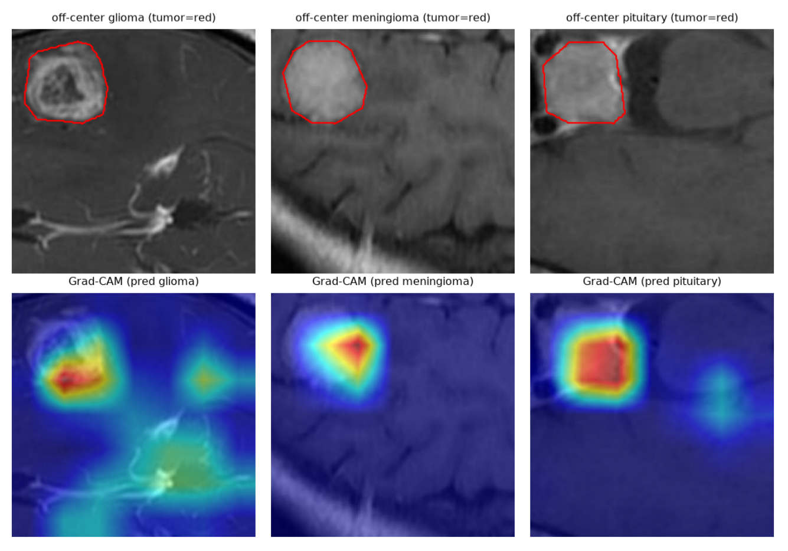

<div align="center">

# Do CNNs Learn Clinically Meaningful Imaging Representations?<br>A Portable Multi-level Representation Audit for Brain Tumor MRI Classification

**Bo-Wei Lai**<sup>1</sup>, **Li-Fen Chen**<sup>2,3,\*</sup>

<sup>1</sup> Department of Biomedical Engineering, National Yang Ming Chiao Tung University, Taipei, Taiwan<br>
<sup>2</sup> Institute of Brain Science, National Yang Ming Chiao Tung University, Taipei, Taiwan<br>
<sup>3</sup> Center for Advanced Radiology and Neuroimaging, National Yang Ming Chiao Tung University, Hsinchu, Taiwan<br>
<sup>\*</sup> Corresponding author

*MICCAI 2026 Workshop on Machine Learning in Clinical Neuroimaging (MLCN)*

[](https://papers.miccai.org/miccai-2026-sat/paper/MLCN_2026_035.pdf)
[](https://papers.miccai.org/miccai-2026-sat/paper/MLCN_2026_035.pdf)
[](https://doi.org/10.1371/journal.pone.0140381)



<sub><b>Figure 1.</b> Shifted-input control. Tumors were re-cropped to the upper-left corner (top, red outlines).
Grad-CAM for the predicted class moves with the tumor rather than staying at the image center (bottom).</sub>

</div>

---

## TL;DR

Brain tumor MRI classifiers already exceed 95% accuracy, so we ask a different question: **what has the network actually learned?** We audit a fine-tuned ResNet-50 at three levels (representation geometry, alignment with radiomic descriptors, and spatial attention) using out-of-fold embeddings from patient-level cross-validation, with no retraining.

| Level | Finding | Number |
|---|---|---|
| Classification | ResNet-50 vs. best radiomics classifier (patient-level 5-fold) | **96.46 ± 1.39%** vs 86.47 ± 1.21% |
| I · Geometry | Embeddings cluster by diagnosis after fine-tuning | ARI **0.904** (pretrained 0.260, radiomics 0.256) |
| II · Radiomic alignment | Share of dimensions with \|ρ\| > 0.5 to a radiomic descriptor | **5.6% → 24.5%** (about 4×); intensity dominates |
| III · Spatial attention | Share of attention on the tumor (τ = 0.5) | meningioma 0.85, pituitary 0.73, **glioma 0.41** (diffuse) |
| Control | Tumors shifted to an image corner (no retraining) | accuracy 85.6%; attention centroid tracks the tumor (r = 0.61 / 0.68) |

## Abstract

Deep learning models for brain tumor MRI classification reach near-saturated accuracy, yet high performance does not guarantee that learned representations reflect clinically meaningful imaging structure. Most interpretability methods rely on saliency maps or architecture-specific modifications, giving only indirect evidence about the geometry and clinical validity of internal features. We propose a model-agnostic, retraining-free representation audit that shifts interpretability from visualization toward quantitative evaluation of learned feature spaces. By utilizing patient-level out-of-fold (OOF) embeddings from cross-validation, the framework maintains strict separation between training and evaluation. It tests three hypotheses: (1) a diagnostic-structure hypothesis, whether embeddings organize by diagnosis; (2) a radiomic-correspondence hypothesis, whether latent features align with radiomic descriptors; and (3) a spatial-stability hypothesis, whether attribution remains stable under tumor-centered spatial perturbation. Auditing a ResNet-50 on the Cheng/Figshare dataset, the audit shows that supervised learning induces a highly structured space, with radiomic alignment increasing about fourfold over the pretrained baseline and strong diagnostic separability (ARI = 0.90). Because the network is optimized on the same diagnostic labels used for evaluation, this organization is expected in direction and is reported as descriptive rather than as independent evidence of clinical validity. Spatial-stability analysis reveals subtype-dependent behavior: focal tumors (meningioma, pituitary) show stable attention consistent with the annotated tumor region, whereas infiltrative gliomas are diffuse and perturbation-sensitive. Overall, representation-level auditing complements post-hoc explainability and offers a practical and reproducible tool for probing whether high-performing medical CNNs learn representations that align with radiomic descriptors and show attention overlap with annotated tumor regions, yielding converging but indirect evidence rather than proof of clinical trustworthiness.

## Method

**Data.** Cheng/Figshare brain tumor MRI: 3,062 contrast-enhanced T1 axial slices from 233 patients (glioma / meningioma / pituitary), each with a tumor polygon. The Roboflow redistribution drops patient IDs, so each slice was matched back to the original `.mat` file to recover **patient IDs and the official five-fold split** (no patient crosses folds). Tumors are cropped with a 3 × 3 contextual box centered on the lesion.

**Model.** ImageNet-pretrained ResNet-50, fully fine-tuned per fold. Every image is embedded (2,048-D global-average-pooling features) only by the fold model that never saw that patient, which gives out-of-fold embeddings for the audit.

**Three audit modules.**

| Module | Question | Measure |
|---|---|---|
| I · Geometric | Does the space organize by diagnosis? | PCA (95% variance) → k-means (k = 3); ARI, NMI vs. labels |
| II · Semantic | Do dimensions align with radiomic descriptors? | Spearman ρ between each dimension and 19 decorrelated descriptors (intensity / shape / texture) |
| III · Spatial | Does attention sit on the lesion? | Grad-CAM vs. tumor polygon: IoU, coverage, tumor / peritumoral / background shares |

Three controls separate learning from the centered crop: the pretrained network on identical inputs, a centered-disk geometric prior, and **shifted inputs** that move the tumor to a corner without retraining.

## Results

**Attention decomposition by class** (centered crops, out-of-fold, τ = 0.5):

| Class | IoU | Tumor | Peritumoral | Background |
|---|---|---|---|---|
| Glioma | 0.252 | 0.409 | 0.428 | 0.163 |
| Meningioma | 0.309 | **0.851** | 0.144 | 0.005 |
| Pituitary | 0.373 | **0.728** | 0.267 | 0.006 |
| Overall | 0.304 | 0.608 | 0.314 | 0.079 |

Fine-tuned specificity is 3.5× the pretrained network's on identical inputs, and on meningioma it exceeds a centered-disk prior (0.851 vs 0.726). With shifted inputs, meningioma and pituitary keep 73% and 72% of attention on tumor + peritumoral tissue, but glioma keeps only 44%. Full tables are in the [paper](https://papers.miccai.org/miccai-2026-sat/paper/MLCN_2026_035.pdf).

**Evaluation protocol matters.** A random slice-level split inflated accuracy to 99.0% through patient leakage, and a single patient-disjoint split swung by about 5 points between validation and test. All reported numbers therefore use patient-level five-fold cross-validation.

## Limitations

The evidence is indirect. Label supervision partly explains the diagnosis-aligned geometry, radiomic descriptors are limited proxies for clinical concepts, descriptor selection was transductive, and alignment scores have no permutation null. Grad-CAM is associative, not causal. The study uses single-center 2D T1 post-contrast data and one backbone.

## Repository contents

The paper is available open access from the link above. `docs/` holds the README figure. `archive/` keeps the documentation of an **early exploratory version** of this project (single slice-level split, 99.03% accuracy). Those numbers are superseded by the patient-level protocol and are not comparable to the paper; see [archive/README.md](archive/README.md).

## Citation

```bibtex
@inproceedings{lai2026cnnaudit,
  title     = {Do {CNNs} Learn Clinically Meaningful Imaging Representations? A Portable Multi-level Representation Audit for Brain Tumor {MRI} Classification},
  author    = {Lai, Bo-Wei and Chen, Li-Fen},
  booktitle = {Machine Learning in Clinical Neuroimaging (MLCN), MICCAI 2026 Workshops},
  year      = {2026}
}
```

## Acknowledgments

This work was partially supported by the National Science and Technology Council under Grants NSTC 113-2740-H-A49-002-RE2 and NSTC 114-2410-H-A49-078.
